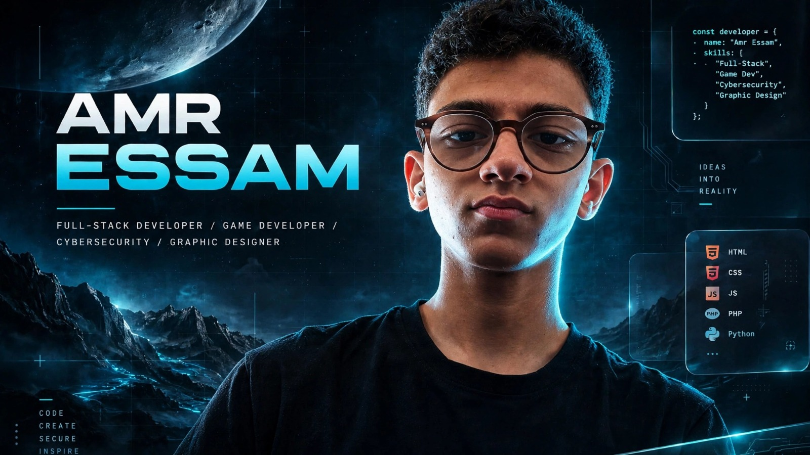

  

<h1 align="center">A.ESSAM</h1>

SOFTWARE ENGINEER & CREATIVE DEVELOPER

---

### 👨‍💻 About Me
> Software Engineering student based in Kafr El Dawar, Egypt. Building immersive digital experiences, secure systems, and creative visual projects.

- 🌍 **Location:** Egypt - Open to Remote Worldwide
- 🛡️ **Focus:** Cybersecurity, Full-Stack, Game Dev (Godot)
- 🎨 **Creative:** Graphic Design, Branding, Car Posters
- 🌱 **Learning:** Clean Architecture, Penetration Testing, React

| 5 | 5 | 6 | 8 |
|:---:|:---:|:---:|:---:|
| PROJECTS | CERTIFICATES | LOGOS | CAR POSTERS |

---

# Tech Stack

### Languages

### Frontend & Game Dev

### Backend & Security

---

# GitHub Analytics

# Contribution Snake

---

